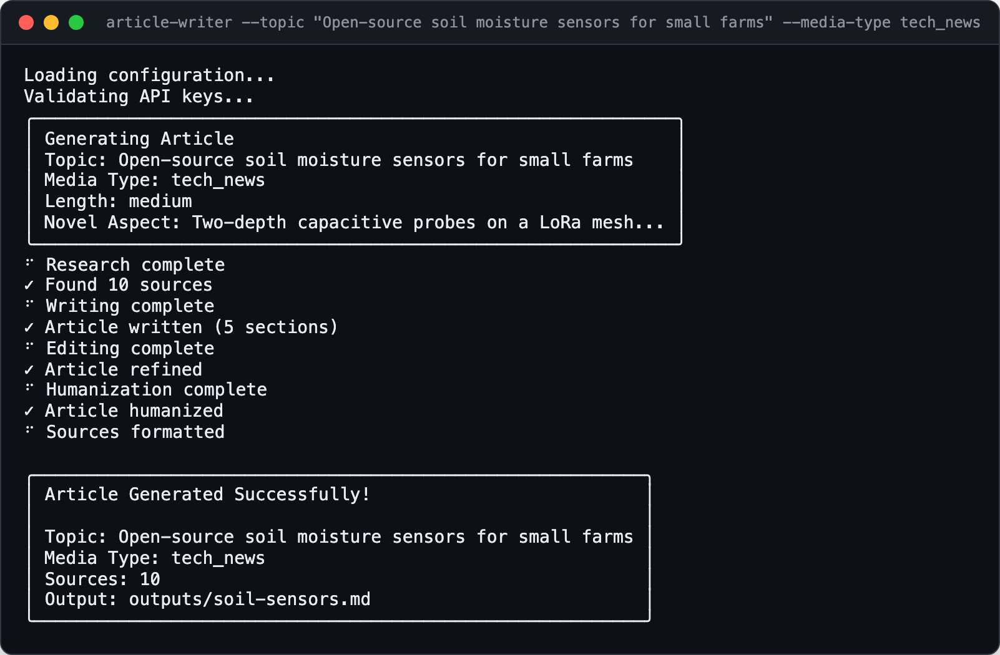

<div align="center">

<h1>Media Article Writer</h1>

<p><b>Researched articles, in a publication's voice.</b></p>

<p><i>Turning a piece of work into a news story means hours of finding sources, matching a house style and cutting the stiff phrasing. This hands that to a chain of agents.</i></p>

<h6>


</h6>

<a href="#how-it-works"><b>How it works</b></a> ·
<a href="#features"><b>Features</b></a> ·
<a href="#install"><b>Install</b></a> ·
<a href="#usage"><b>Usage</b></a>

<br><br>



<sub>Real CLI output with the LLM and search providers swapped for local stubs, so no API was called. Demo topic.</sub>

</div>

<br>

## Why

Writing up a project for a magazine, a tech site or a journal is three jobs: research what
else exists, write in that outlet's structure and tone, and then edit out the phrasing that
sounds machine-made. Media Article Writer runs those as separate agents over one topic and
saves a Markdown article with front matter and a deduplicated source list.

## How it works

<table>
<tr>
<td width="25%" valign="top">

**1 · Research**

The LLM turns the topic into search queries; the top three run against Exa or Google
Custom Search, and results are deduplicated and summarised. Research is cached in
`.cache/research/`.

</td>
<td width="25%" valign="top">

**2 · Write**

The writer fills the section template for the chosen media type
(`src/config/templates.yaml`) in that outlet's tone (`src/config/tones.yaml`).

</td>
<td width="25%" valign="top">

**3 · Edit**

An editor pass checks flow, consistency and tone. If it fails, the draft goes through
unchanged.

</td>
<td width="25%" valign="top">

**4 · Humanize**

One to three passes look for stock phrases ("It is important to note", "Moreover") and
flat sentence rhythm, and rewrite them.

</td>
</tr>
</table>

Sources are then cleaned and formatted by an LLM pass, with a plain formatter as the fallback,
and appended to the article.

## Features

- **Four publication styles.** `tech_news`, `research_magazine`, `scientific_journal` and
  `academic_news`, each with its own section template and tone.
- **Your context, not just the topic.** A short JSON file (or interactive prompts) describing
  what is new, how it works and who it is for steers both the search queries and the draft.
- **Find sources for an article you already wrote.** `--find-sources draft.md` extracts its
  topics, researches each one and writes `draft-sources.md`.
- **Research cache.** Re-running a topic reuses the search results; `--fresh-research`,
  `--clear-cache` and `--clear-all-cache` control it.
- **Swappable providers.** Gemini or Perplexity for text; Exa, Google Custom Search or CrewAI's
  Exa tool for search, chosen in `config.yaml`.
- **Three lengths.** Short (500-800 words), medium (1000-1500) or long (2000+).

## Install

Needs Python 3.10+, [uv](https://github.com/astral-sh/uv), one LLM key (Gemini or Perplexity)
and one search key (Exa, or Google API key plus Custom Search engine ID).

```bash
git clone https://github.com/parthchandak02/media-assistant.git
cd media-assistant
uv sync
cp .env.example .env              # add your keys
cp config.yaml.example config.yaml
```

## Usage

```bash
uv run article-writer --topic "New AI safety framework" --media-type tech_news             # interactive context questions
uv run article-writer --topic "..." --media-type research_magazine --context-file ctx.json  # context from a file
uv run article-writer --topic "..." --media-type scientific_journal --length long --no-interactive
uv run article-writer --find-sources article-no-sources/sample.md                          # sources for an existing draft
uv run article-writer --topic "..." --fresh-research -v                                    # skip the cache, show each step
```

Articles land in `outputs/` as `{date}_{topic}_{media_type}.md` unless you pass `--output`.

<details>
<summary><b>Context file</b></summary>

```json
{
  "novel_aspect": "What makes your approach new",
  "technology_details": "How it works",
  "problem_solved": "What problem it solves",
  "use_cases": "Where it applies"
}
```

</details>

<details>
<summary><b>Media types</b></summary>

| Type | Modelled on | Sections |
|---|---|---|
| `tech_news` | TechCrunch, Wired, The Verge | headline, subheadline, opening, the story, why it matters, what next |
| `research_magazine` | Scientific American, Quanta | headline, subheadline, lead, background, discovery, impact, future |
| `scientific_journal` | Nature, Science, Cell | title, abstract, introduction, methodology, results, discussion, conclusion |
| `academic_news` | Inside Higher Ed | headline, lead, achievement, significance, context, recognition, future |

Edit `src/config/templates.yaml` and `src/config/tones.yaml` to change them or add your own.

</details>

<details>
<summary><b>Configuration (config.yaml)</b></summary>

| Key | Default | |
|---|---|---|
| `llm.provider` / `llm.model` | `gemini` / `gemini-2.5-flash` | or `perplexity` with `sonar-pro` / `sonar` |
| `search.provider` | `exa` | `exa`, `google` or `crewai` (needs `crewai-tools`) |
| `search.max_results` | `10` | sources kept per article |
| `search.include_domains` | `[]` | restrict search, for example `["nature.com"]` |
| `article.media_type` / `length` | `research_magazine` / `medium` | overridden by CLI flags |
| `humanizer.enabled` / `passes` / `intensity` | `true` / `2` / `medium` | 1-3 passes; `low`, `medium`, `high` |
| `output.directory` | `./outputs` | |

API keys go in `.env`, never in `config.yaml`.

</details>

<details>
<summary><b>All options</b></summary>

| Option | |
|---|---|
| `--topic TEXT` | Topic to write about (required unless `--find-sources`) |
| `--media-type` | `scientific_journal`, `research_magazine`, `tech_news`, `academic_news` |
| `--length` | `short`, `medium`, `long` |
| `--context-file PATH` | Load context from JSON instead of prompting |
| `--interactive / --no-interactive` | Ask the context questions (default on) |
| `--output PATH` | Output file (auto-named otherwise) |
| `--config PATH` | Config file (default `config.yaml`) |
| `--use-cache / --no-cache`, `--fresh-research` | Reuse or bypass cached research |
| `--clear-cache`, `--clear-all-cache` | Drop cached research for one topic, or all |
| `--find-sources PATH`, `--sources-output PATH` | Build a sources file for an existing article |
| `-v, --verbose` | Show queries, sections and each pass |

</details>

<details>
<summary><b>Project layout</b></summary>

```
src/main.py        CLI entry point (article-writer)
src/pipeline.py    Orchestrates research, write, edit, humanize, sources
src/agents/        Research, writer, editor, humanizer, sources formatter, topic extractor
src/config/        Media-type tones and section templates
src/utils/         LLM and search providers, cache, formatter, AI-phrase detection
tests/             Unit, agent and integration tests (pytest)
```

</details>

<br>

<div align="center">
<sub>Built with Click, Rich, the Gemini and Perplexity APIs, and Exa search.</sub>
</div>
